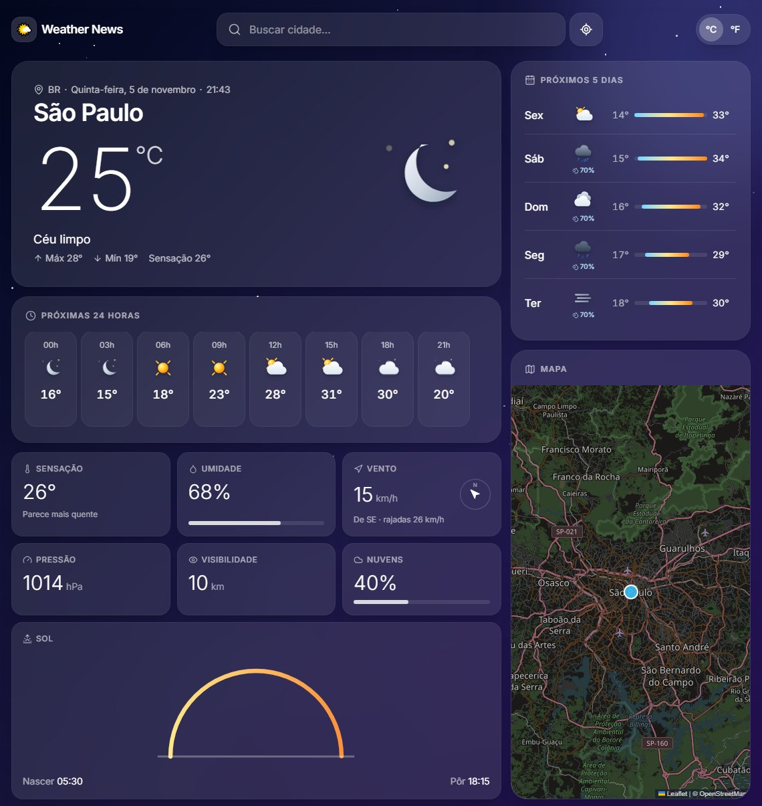
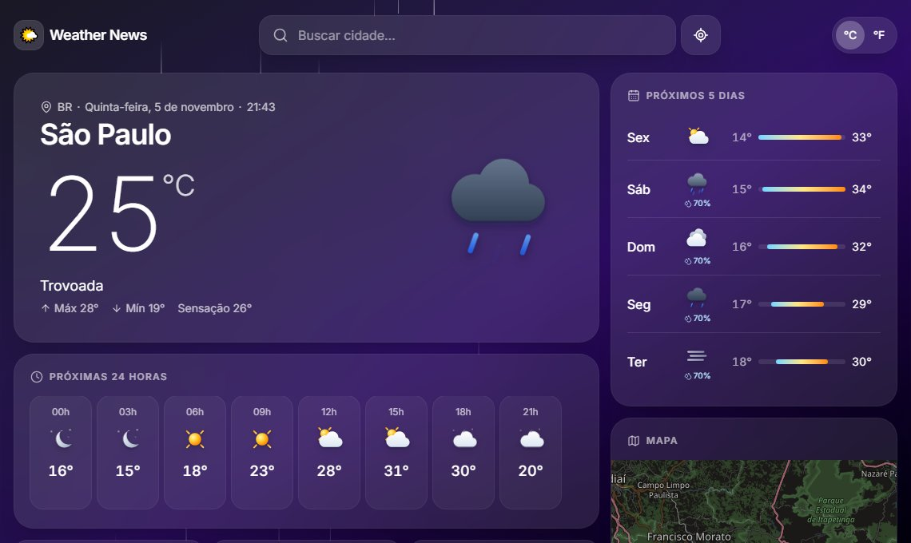

# 🌤️ Weather News

Clima em tempo real, previsão de 5 dias, mapa e notícias da cidade que você pesquisar, com um visual que muda conforme o tempo lá fora: sol, noite estrelada, chuva, tempestade, neve ou névoa.

[](https://github.com/ChoyaSpadin/weather-news/actions/workflows/ci.yml)
[](LICENSE)



<details>
<summary>O fundo e os ícones mudam com o clima (exemplo: trovoada)</summary>



</details>

## ✨ Funcionalidades

- 🔎 Busca de cidades com autocomplete, navegação por teclado e buscas recentes
- 📍 Botão "usar minha localização"
- 🌡️ Clima atual: temperatura, sensação, umidade, vento (com bússola), pressão, visibilidade e nuvens
- 🕒 Próximas 24 horas e 🗓️ previsão de 5 dias com faixa de mínima e máxima
- 🌅 Arco do sol entre o nascer e o pôr
- 🗺️ Mapa interativo (OpenStreetMap, sem chave)
- 📰 Notícias da cidade (GNews)
- 🎬 Animações com Motion, fundo animado por clima e ícones SVG animados
- °C / °F, layout responsivo e respeito a "reduzir movimento" do sistema

## 🔐 Como as chaves ficam protegidas

O navegador nunca recebe as chaves de API. Ele chama `/api/weather`, `/api/geo` e `/api/news`, que são funções serverless (pasta [`api/`](api)) rodando na Vercel. Só elas leem `OPENWEATHER_KEY` e `GNEWS_KEY` das variáveis de ambiente.

```
Navegador ──► /api/* (Vercel) ──► OpenWeather / GNews
                 └─ chaves ficam aqui
```

## 🚀 Rodando localmente

Requisitos: Node 20 ou mais novo.

```bash
git clone https://github.com/ChoyaSpadin/weather-news.git
cd weather-news
npm install
```

**Sem chaves (dados de exemplo):**

```bash
npm run dev:mock
```

Dá para trocar o clima de exemplo em `.env.mock` (`MOCK_CODE=500` chuva, `211` trovoada, `600` neve, `741` névoa).

**Com dados reais:** copie `.env.example` para `.env`, preencha as chaves e rode `npm run dev`. O servidor do Vite serve as mesmas funções de `api/` localmente.

- OpenWeather: crie uma conta grátis e pegue a chave em <https://home.openweathermap.org/api_keys>
- GNews: <https://gnews.io/> (plano grátis)

## ☁️ Deploy na Vercel

1. Importe o repositório em <https://vercel.com/new> (a Vercel detecta o Vite sozinha).
2. Em **Settings → Environment Variables**, adicione `OPENWEATHER_KEY` e `GNEWS_KEY`.
3. Faça o deploy. As funções de `api/` sobem junto com o site.

## 🧪 Scripts

| Comando | O que faz |
| --- | --- |
| `npm run dev` | Servidor local com dados reais (precisa do `.env`) |
| `npm run dev:mock` | Servidor local com dados de exemplo |
| `npm test` | Testes (Vitest) |
| `npm run lint` | ESLint |
| `npm run build` | Build de produção em `dist/` |

## 🗂️ Estrutura

```
api/                 funções serverless (Vercel)
  _lib/handlers.js   lógica das chamadas, validação e erros
  _lib/devServer.js  serve /api no `npm run dev`
  _lib/mock.js       dados de exemplo
src/
  components/        cards, busca, cenário de fundo, ícones animados
  hooks/             useWeather, useDebounce, useLocalStorage, useCountUp
  lib/               chamadas à API, formatação, previsão, cenários
tests/               testes do backend e das funções de previsão
```

## 🛠️ Tecnologias

[React 19](https://react.dev/) · [Vite](https://vitejs.dev/) · [Tailwind CSS 4](https://tailwindcss.com/) · [Motion](https://motion.dev/) · [React Leaflet](https://react-leaflet.js.org/) · [Lucide](https://lucide.dev/) · [Vitest](https://vitest.dev/)

Dados: [OpenWeather](https://openweathermap.org/) · [GNews](https://gnews.io/) · [OpenStreetMap](https://www.openstreetmap.org/copyright)

## 📄 Licença

[MIT](LICENSE)
